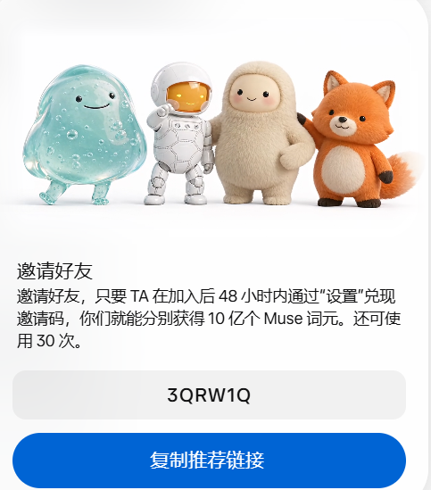
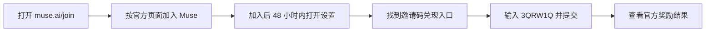

# Muse 注册与邀请码使用指南

快来看看你的个人 AI 智能体 Muse。

**加入地址：[https://muse.ai/join](https://muse.ai/join)**  
**邀请码：`3QRW1Q`**

根据分享者提供的邀请截图：在加入后的 **48 小时内**，通过“设置”兑现邀请码，邀请双方可分别获得 **10 亿个 Muse 词元**。活动期限、账户资格、可用次数和奖励到账以 Muse 实际页面显示为准；本项目不承诺奖励必定到账。

## 图 1：邀请卡片与邀请码

上图由分享者提供，并非本项目实时查询的活动状态。截图中的“还可使用 30 次”只是截图当时的显示，不代表当前剩余次数。

## 图 2：使用流程

1. 打开加入地址，按页面选择网页、iOS 或 Android 入口。
2. 完成官方注册或加入流程，不要把密码或验证码交给他人。
3. 在加入后的 48 小时内进入 Muse“设置”，寻找邀请码兑现入口。具体名称和位置可能随版本变化，图 2 是操作示意，不是设置页面截图。
4. 输入 **3QRW1Q** 并按官方提示提交；在应用中确认兑现和到账结果。
5. 没有入口、已过期限或不符合资格时，查看官方说明或联系官方支持，不要重复注册来试图获取奖励。

## 在 Windows 使用独立浏览器

下载本项目发布页中的 ZIP，全部解压，运行 Install.cmd。安装后点击桌面 Muse-US，先在 Windscribe 登录并手动连接所需节点，回到窗口输入 YES，然后浏览器打开 Muse 加入页。详见 [安装说明](README.md)。

Muse-US 是本项目的快捷方式名称。独立 Data 目录只隔离浏览器本地数据；Windscribe 连接状态、服务地区资格、账号访问条件和邀请奖励仍以各自官方规则为准。

中国大陆用户访问 GitHub、Google 下载或 Muse 可能受网络条件影响。本项目不保证下载成功、VPN 可连接或 Muse 可用。

本指南由分享者发布，不是 Muse、Google 或 Windscribe 的官方文档。加入页已于 2026-10-14 核验；奖励规则仅根据分享者提供的截图整理，未完成真实注册或兑现测试。
